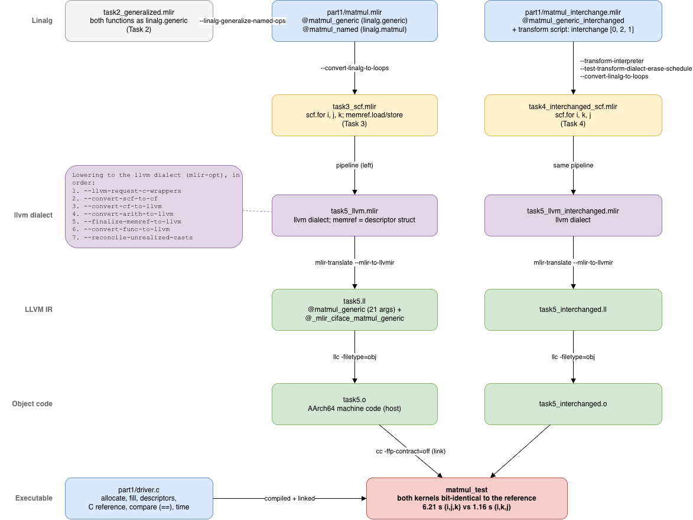

# MLIR Tasks — Part 1: Matrix Multiplication in MLIR


## Task 1 — Build LLVM/MLIR and the starter project

### 1.1 LLVM/MLIR

scripts/llvm_build.sh configures and installs LLVM/MLIR at tag llvmorg-23.1.3:

```bash
cmake -S "$LLVM_SRC/llvm" -B "$LLVM_BUILD" -G Ninja \
  -DCMAKE_BUILD_TYPE=Release \
  -DLLVM_ENABLE_ASSERTIONS=ON \
  -DLLVM_ENABLE_PROJECTS=mlir \
  -DLLVM_TARGETS_TO_BUILD=host \
  -DLLVM_INSTALL_UTILS=ON \
  -DLLVM_BUILD_EXAMPLES=OFF \
  -DLLVM_ENABLE_BINDINGS=OFF \
  -DLLVM_PARALLEL_LINK_JOBS=1 \
  -DCMAKE_INSTALL_PREFIX="$LLVM_PREFIX"

ninja -C "$LLVM_BUILD" -j6 install
```

| Option | Choice and reason |
|---|---|
| `CMAKE_BUILD_TYPE=Release` | Optimized and much smaller than debug |
| `LLVM_ENABLE_ASSERTIONS=ON` | Keeps LLVM/MLIR's internal checks. |
| `LLVM_ENABLE_PROJECTS=mlir` | Builds LLVM + MLIR only (no clang, lld, …). |
| `LLVM_TARGETS_TO_BUILD=host` | Only the code generator for the build machine |
| `LLVM_INSTALL_UTILS=ON` | Installs utils needed for project |
| `LLVM_BUILD_EXAMPLES=OFF`, `LLVM_ENABLE_BINDINGS=OFF` | Skip unneeded components. |
| `LLVM_PARALLEL_LINK_JOBS=1` and `-j6` | The machine has 8 GB of RAM and linking jobs costs memory|
| `CMAKE_INSTALL_PREFIX` | Separate install directory, as demanded. |

### 1.2 Starter project

`scripts/project_build.sh`:

```bash
cmake -G Ninja -S "$REPO_DIR" -B "$REPO_DIR/build" \
  -DMLIR_DIR="$LLVM_PREFIX/lib/cmake/mlir" \
  -DLLVM_EXTERNAL_LIT="$LLVM_BUILD/bin/llvm-lit"
ninja -C "$REPO_DIR/build" check-standalone-opt
Result:
```
-- Precompiled headers enabled.
-- Configuring done (1.7s)
-- Generating done (0.2s)
-- Build files have been written to: /Volumes/mlirwork/MLIR-task-tud/build
ninja: Entering directory `/Volumes/mlirwork/MLIR-task-tud/build'
[0/1] Running the standalone-opt regression tests

Testing Time: 0.47s

Total Discovered Tests: 1
  Passed: 1 (100.00%)
```

---

## Task 2 — Matrix multiplication in Linalg

Reference (A is M×K, B is K×N, C is M×N):

```c
for (i = 0; i < M; i++)
  for (j = 0; j < N; j++)
    for (k = 0; k < K; k++)
      C[i][j] += A[i][k] * B[k][j];
```

`part1/matmul.mlir`:

```mlir
#map_A = affine_map<(d0, d1, d2) -> (d0, d2)>   // A[i][k]
#map_B = affine_map<(d0, d1, d2) -> (d2, d1)>   // B[k][j]
#map_C = affine_map<(d0, d1, d2) -> (d0, d1)>   // C[i][j]

func.func @matmul_generic(%A: memref<?x?xf64>, %B: memref<?x?xf64>, %C: memref<?x?xf64>) {
  linalg.generic {indexing_maps = [#map_A, #map_B, #map_C],
                  iterator_types = ["parallel", "parallel", "reduction"]}
      ins(%A, %B : memref<?x?xf64>, memref<?x?xf64>)
      outs(%C : memref<?x?xf64>) {
  ^bb0(%a: f64, %b: f64, %c: f64):
    %p = arith.mulf %a, %b : f64
    %s = arith.addf %c, %p : f64
    linalg.yield %s : f64
  }
  return
}

func.func @matmul_named(%A: memref<?x?xf64>, %B: memref<?x?xf64>, %C: memref<?x?xf64>) {
  linalg.matmul ins(%A, %B : memref<?x?xf64>, memref<?x?xf64>) outs(%C : memref<?x?xf64>)
  return
}
```

`memref<?x?xf64>`: 2-D buffers of doubles whose sizes are only known at run time (dynamic shapes).

### Named -> generic

Pass: `--linalg-generalize-named-ops` ("Convert named ops into generic ops"), found with `mlir-opt --help | grep -i generaliz`. 

```bash
make task2   # mlir-opt part1/matmul.mlir --linalg-generalize-named-ops -o part1/IRs/generated/task2_generalized.mlir
```

Result (`task2_generalized.mlir`): both functions become an identical `linalg.generic`.

```mlir
#map  = affine_map<(d0, d1, d2) -> (d0, d2)>
#map1 = affine_map<(d0, d1, d2) -> (d2, d1)>
#map2 = affine_map<(d0, d1, d2) -> (d0, d1)>
...
linalg.generic {indexing_maps = [#map, #map1, #map2], iterator_types = ["parallel", "parallel", "reduction"]}
    ins(%arg0, %arg1 : memref<?x?xf64>, memref<?x?xf64>) outs(%arg2 : memref<?x?xf64>) {
^bb0(%in: f64, %in_0: f64, %out: f64):
  %0 = arith.mulf %in, %in_0 : f64
  %1 = arith.addf %out, %0 : f64
  linalg.yield %1 : f64
}
```

**Comparison with the handwritten version.**

- **Indexing maps, Iterator types:** identical. 
- **Body:** same operations in the same order, only naming is not kept by MLIR.
- **Explanation:** since addf is an addition and it's commutative, so the order does not matter here + types: since all are f64 we didn't have a type generalization on linalg.matmul

### Q1.

The iteration space has three dimensions, d0 = i, d1 = j, d2 = k.

| Operand | Indexing map | Element accessed at (d0, d1, d2) |
|---|---|---|
| A | `(d0, d1, d2) -> (d0, d2)` | A[d0][d2] = A[i][k] |
| B | `(d0, d1, d2) -> (d2, d1)` | B[d2][d1] = B[k][j] |
| C | `(d0, d1, d2) -> (d0, d1)` | C[d0][d1] = C[i][j] |

`iterator_types = ["parallel", "parallel", "reduction"]`, one entry per dimension, positionally (first entry = d0).
A dimension that appears in the output map is parallel, if it doesn't the it's a reduction (changing it writes the same output element, so values combines)

### Q2. 

- **Why C is an outs operand.** the computation is : C += A·B so C is what the operation writes (it's also read) 
- **What its block argument holds.** the body is executed once per point, its arguments are the elements selectedby the map %ins and %outs is the current value of c[i][j] at k0 its whatever c contains before the call and after its the partial sum accumulated. lialg.yield gives the new value which is written back to C
- **Does linalg.matmul initialize C to zero? *** No, in the generelized form the body reads %out and adds the product to it (%1 = arith.addf %out, %0) there is no fill or zero constant anywhere.

### Q3. 

**d2 (k) is the reduction**: it does not appear in C's map, so for a fixed (i, j), all K iterations along k write the same element C[i][j] and their products are summed.

**Verification does not catch a wrong annotation.** Observed during development: a version with iterator_types = ["reduction", "reduction", "parallel"] (positions shifted by mistake) was accepted by mlir-opt part1/matmul.mli without any error, and printed back normally.

And for ["parallel", "parallel", "parallel"]:

```bash

macbookair@Big-Yass-Macbook MLIR-task-tud % mlir-opt part1/matmul.mlir 
#map = affine_map<(d0, d1, d2) -> (d0, d2)>
#map1 = affine_map<(d0, d1, d2) -> (d2, d1)>
#map2 = affine_map<(d0, d1, d2) -> (d0, d1)>
module {
  func.func @matmul_generic(%arg0: memref<?x?xf64>, %arg1: memref<?x?xf64>, %arg2: memref<?x?xf64>) {
    linalg.generic {indexing_maps = [#map, #map1, #map2], iterator_types = ["parallel", "parallel", "parallel"]} ins(%arg0, %arg1 : memref<?x?xf64>, memref<?x?xf64>) outs(%arg2 : memref<?x?xf64>) {
    ^bb0(%in: f64, %in_0: f64, %out: f64):
      %0 = arith.mulf %in, %in_0 : f64
      %1 = arith.addf %out, %0 : f64
      linalg.yield %1 : f64
    }
    return
  }
  func.func @matmul_named(%arg0: memref<?x?xf64>, %arg1: memref<?x?xf64>, %arg2: memref<?x?xf64>) {
    linalg.matmul ins(%arg0, %arg1 : memref<?x?xf64>, memref<?x?xf64>) outs(%arg2 : memref<?x?xf64>)
    return
  }
}
```

**Is it correct? *** No. The verifier checks structure (number of maps and iterator types, operand and block-argument types...) It does not check that the iterator types of the body. Marking k parallel claims that iterations along k are independent, which is false: they all read-modify-write C[i][j].


---

## Task 3 - Lower to loops

```bash
make task3
# mlir-opt part1/matmul.mlir --convert-linalg-to-loops        -o part1/IRs/generated/task3_scf.mlir
# mlir-opt part1/matmul.mlir --convert-linalg-to-affine-loops -o part1/IRs/generated/task3_affine.mlir
```

Annotated versions: `part1/IRs/task3_scf_annotated.mlir`, `part1/IRs/task3_affine_annotated.mlir`.

```mlir
// Generated by: mlir-opt part1/matmul.mlir --convert-linalg-to-loops
// %arg0 = A (M x K), %arg1 = B (K x N), %arg2 = C (M x N); sizes are read at run time
func.func @matmul_generic(%arg0: memref<?x?xf64>, %arg1: memref<?x?xf64>, %arg2: memref<?x?xf64>) {
  %c1 = arith.constant 1 : index
  %c0 = arith.constant 0 : index
  %dim = memref.dim %arg0, %c0 : memref<?x?xf64>     // M = rows of A
  %dim_0 = memref.dim %arg0, %c1 : memref<?x?xf64>   // K = columns of A
  %dim_1 = memref.dim %arg1, %c1 : memref<?x?xf64>   // N = columns of B
  scf.for %arg3 = %c0 to %dim step %c1 {             // i loop: 0..M-1
    scf.for %arg4 = %c0 to %dim_1 step %c1 {         // j loop: 0..N-1
      scf.for %arg5 = %c0 to %dim_0 step %c1 {       // k loop: 0..K-1 (reduction)
        %0 = memref.load %arg0[%arg3, %arg5] : memref<?x?xf64>   // A[i][k]
        %1 = memref.load %arg1[%arg5, %arg4] : memref<?x?xf64>   // B[k][j]
        %2 = memref.load %arg2[%arg3, %arg4] : memref<?x?xf64>   // C[i][j]
        %3 = arith.mulf %0, %1 : f64                             // A[i][k] * B[k][j]
        %4 = arith.addf %2, %3 : f64                             // C[i][j] + A[i][k] * B[k][j]
        memref.store %4, %arg2[%arg3, %arg4] : memref<?x?xf64>   // write back to C[i][j]
      }
    }
  }
  return
}
```

Observations:

-d0 is the outermost loop, d2 the innermost.
- Bounds are read at run time
- Both functions lower to identical loops, confirming Task 2. `--convert-linalg-to-loops` also lowers `linalg.matmul` directly, without prior generalization.
- scf vs affine:
  - scf.for is a general loop: bounds and step are arbitrary index SSA values, which is why the constants 0 and 1 must exist as arith.constant.
  - affine.for only accepts affine bounds (constants, loop variables, symbols such as %dim), so they are written directly

### Q4. 

- `--convert-linalg-to-loops` (scf loops) and --convert-linalg-to-affine-loops (affine loops).
- **How:** `mlir-opt --help | grep -i "convert-linalg"`, after a first unsuccessful search. so we learned that it goes by convert source to target generally. + (https://mlir.llvm.org/docs/Passes/)
- Other sources used: the upstream tests (llvm-project/mlir/test/Dialect/Linalg/)

---

## Task 4 - Loop interchange

### Why loop order matters

- Memory is much slower than the processor, so caches keep recently used data close.
- Memory is transferred in cache lines: 64 bytes (8 doubles) on most x86 processors, 128 bytes (16 doubles) on the Apple M1. A miss on one element brings its neighbours for free.
- Three hardware mechanisms reward the innermost loop walking memory in order: caches (spatial locality), the hardware prefetcher (sequential streams), and SIMD (contiguous operands).

Row-major layout: X[r][c] is at position r × cols + c. The stride of an access is how far that position moves when the innermost loop variable increases by 1:

| Kind | Stride | Cost per innermost iteration |
|---|---|---|
| Contiguous | 1 | One cache miss every 16 (M1) iterations: vectorizable |
| Unchanged | 0 | The value is loaded once and kept in a register: no memory traffic |
| Large stride | a whole row | A new cache line every iteration |


### Q5. 

| Innermost | A[i][k] | B[k][j] | C[i][j] | Large-stride accesses |
|---|---|---|---|---|
| k (default) | contiguous | **stride N** | unchanged | B |
| j | unchanged | contiguous | contiguous | **none** |
| i | **stride K** | unchanged | **stride N** | A and C |

The default order walks B down its columns. The only choice with no large-stride access is j innermost. In the innermost loop, A[i][k] stays in a register while row k of B and row i of C are accessed

Two orders put j innermost: (i, k, j) and (k, i, j). **Chosen: (i, k, j).** For a fixed i, the same row of C is reused across all k and stays in L1. 

### Q6. 

There is no direct pass for the interchange (since it needs to be parmametrised); it is applied with the transform dialect and then interpreted by mlir-opt --transform-interpreter. part1/matmul_interchange.mlir contains the payload function (renamed @matmul_generic_interchanged after a duplicate symbol in Task 5) and the transform script:

```mlir
module attributes {transform.with_named_sequence} {
  transform.named_sequence @__transform_main(%arg1: !transform.any_op {transform.readonly}) {
    %0 = transform.structured.match ops{["linalg.generic"]} in %arg1 : (!transform.any_op) -> !transform.any_op
    transform.structured.interchange %0 iterator_interchange = [0, 2, 1] : (!transform.any_op) -> !transform.any_op
    transform.yield
  }
}
```

- transform.structured.match returns a *handle* to the payload's linalg.generic ops.
- iterator_interchange lists the old dimensions in their new order, outermost first: [d0, d2, d1] = (i, k, j). Dimensions are numbered from 0: a first attempt with `[1, 3, 2]` was rejected with 'transform.structured.interchange' op expects iterator_interchange to be a permutation, found 1, 3, 2`.
- Source: the upstream test mlir/test/Dialect/Linalg/transform-op-interchange.mlir, and the op definition in mlir/include/mlir/Dialect/Linalg/TransformOps/LinalgTransformOps.td.

```bash
make task4
# mlir-opt part1/matmul_interchange.mlir --transform-interpreter \
#   --test-transform-dialect-erase-schedule --convert-linalg-to-loops \
#   -o part1/IRs/generated/task4_interchanged_scf.mlir
```

--test-transform-dialect-erase-schedule removes the transform script and leaves an empty wrapper 

**Effect at the Linalg level** (before lowering), with the new numbering d0 = i, d1 = k, d2 = j:

```mlir
#map  = affine_map<(d0, d1, d2) -> (d0, d1)>   // A[i][k]
#map1 = affine_map<(d0, d1, d2) -> (d1, d2)>   // B[k][j]
#map2 = affine_map<(d0, d1, d2) -> (d0, d2)>   // C[i][j]
iterator_types = ["parallel", "reduction", "parallel"]
```

The interchange renumbers the dimensions in every map and permutes the iterator types accordingly - the body is unchanged.

**Lowered result** (task4_interchanged_scf.mlir):

```mlir
scf.for %arg3 = %c0 to %dim step %c1 {         // i: 0..M-1
  scf.for %arg4 = %c0 to %dim_0 step %c1 {     // k: 0..K-1   (%dim_0 = dim 1 of A)
    scf.for %arg5 = %c0 to %dim_1 step %c1 {   // j: 0..N-1   (%dim_1 = dim 1 of B)
      %0 = memref.load %arg0[%arg3, %arg4]     // A[i][k]  unchanged in the j loop
      %1 = memref.load %arg1[%arg4, %arg5]     // B[k][j]  contiguous
      %2 = memref.load %arg2[%arg3, %arg5]     // C[i][j]  contiguous
      ...
      memref.store %4, %arg2[%arg3, %arg5]     // C[i][j]
```

**Does the same approach work directly on @matmul_named? *** No, Tested separately in part1/matmul_interchange_named.mlir (matching linalg.matmul instead of linalg.generic):

```
part1/matmul_interchange_named.mlir:12:5: error: transform applied to the wrong op kind
    transform.structured.interchange %0 iterator_interchange = [0, 2, 1] : ...
part1/matmul_interchange_named.mlir:3:7: note: when applied to this op
      linalg.matmul ins(%A, %B : ...) outs(%C : ...)
```

transform.structured.interchange only applies to linalg.generic. Interchanging means rewriting the indexing maps and iterator types, and a named op does not expose them as editable attributes so to make the interchange possible we have to generalize first

(with two @__transform_main sequences in one file, only the first one ran, so @matmul_named was silently left unchanged, with no error. Isolating the test in its own file produced the real error above.)

### Q7. 
**Dependences.** 

Reordering loops is legal if we respect the dependances, for example if in a case where a(i)(j+1) in i,j we get (i-1,j+1) so we're reading a bad value. In this case A and B are read-only C is read and write with same i,j. so all dependances are between iterations differing only in k (carried by reduction) 
**Why moving the reduction loop is legal here.** Moving k from innermost to middle does not change the relative order of the iterations that touch the same C[i][j]. Trace for C[0][0] with K = 3:

- (i, j, k): i = 0, j = 0, then k = 0, 1, 2 -> C[0][0] receives A[0][0]B[0][0], A[0][1]B[1][0], A[0][2]B[2][0], in that order.
- (i, k, j): i = 0; k = 0: j = 0 adds A[0][0]B[0][0] (then other j); k = 1: j = 0 adds A[0][1]B[1][0]; k = 2: j = 0 adds A[0][2]B[2][0].

Same terms, same order

**Experimental confirmation** (Task 5): with non-integer inputs (A[i][k] = 1/(i+k+1), B[k][j] = 1/(k+j+2), so that additions round), the original and interchanged MLIR kernels both match the C reference exactly (compared with ==) on 1000×1000 matrices, once FMA contraction is disabled in the reference (see Task 5).

---

## Task 5 - Lower to LLVM, link and run

### Q8. 


Notes: numbers from a single run.
```bash
make task5
```

**1. MLIR -> `llvm` dialect** (`mlir-opt`, same pass list for both versions):

```
--llvm-request-c-wrappers
--convert-scf-to-cf
--convert-cf-to-llvm
--convert-arith-to-llvm
--finalize-memref-to-llvm
--convert-func-to-llvm
--reconcile-unrealized-casts
```

  | Pass | What it does |
  |---|---|
  | `--llvm-request-c-wrappers` | Marks every function so a C-callable `_mlir_ciface_` wrapper is generated |
  | `--convert-scf-to-cf` | Replaces the scf loops by blocks and branches (a CFG) |
  | `--convert-cf-to-llvm` | Turns the cf branches into llvm branches |
  | `--convert-arith-to-llvm` | Turns arith operations (constants, add, mul, compare) into llvm ones |
  | `--finalize-memref-to-llvm` | Turns each memref into its descriptor struct, and loads/stores into address computation + llvm.load/store |
  | `--convert-func-to-llvm` | Turns func into llvm.func; each memref argument becomes 7 values (hence 21 arguments) |
  | `--reconcile-unrealized-casts` | Removes the temporary casts left between converted and not-yet-converted values |

**2. llvm dialect -> LLVM IR:** mlir-translate --mlir-to-llvmir. Only accepts dialects that have an LLVM IR translation.

**3. LLVM IR -> object file:** llc -filetype=obj, from the LLVM built in Task 1. llc targets the host by default (AArch64 here). It performs code generation only (instruction selection, register allocation, scheduling...), not LLVM's middle-end optimization pipeline (opt -O2/-O3..)

**4. Link:** cc -ffp-contract=off part1/driver.c task5.o task5_interchanged.o -o matmul_test.

The generated .ll shows both entry points:

```llvm
define void @matmul_generic(ptr %0, ptr %1, i64 %2, i64 %3, i64 %4, i64 %5, i64 %6, ptr %7, ...)   ; 21 arguments
define void @_mlir_ciface_matmul_generic(ptr %0, ptr %1, ptr %2) {
  %4 = load { ptr, ptr, i64, [2 x i64], [2 x i64] }, ptr %0, align 8
  ...
  call void @matmul_generic(ptr %5, ptr %6, i64 %7, ...)
```

The wrapper loads each descriptor through its pointer, extracts the fields, and calls the expanded function.

**Why this order.** Two rules:

1. A pass that creates operations of a dialect must run before that dialect's conversion.
 --convert-scf-to-cf produces cf branches and arith comparisons and increments, so it must come before --convert-cf-to-llvm and --convert-arith-to-llvm. --llvm-request-c-wrappers must be before --convert-func-to-llvm, which reads the attribute it sets.
2. --reconcile-unrealized-casts must run last, once every dialect is converted (as a "cleanup").

The relative order of the other *-to-llvm passes is flexible

**What happens if one pass is left out** (experiment):

- Without --finalize-memref-to-llvm:

  ```
  test.mlir:34:12: error: Dialect `memref' not found for custom op 'memref.dim'
      %dim = memref.dim %26, %30 : memref<?x?xf64>
  test.mlir:34:12: note: Available dialects: acc, arm_neon, arm_sme, arm_sve, builtin, dlti, func, gpu, llvm, nvvm, omp, ptr, rocdl, spirv, vcix, xevm ; ...
  ```

  mlir-translate only registers dialects with a direct LLVM IR translation
  
- without --convert-scf-to-cf: 
```
test.mlir:52:5: error: Dialect `scf' not found for custom op 'scf.for' 
    scf.for %arg21 = %27 to %33 step %25 {
    ^
test.mlir:52:5: note: Available dialects: acc, arm_neon, arm_sme, arm_sve, builtin, dlti, func, gpu, llvm, nvvm, omp, ptr, rocdl, spirv, vcix, xevm ; for more info on dialect registration see https://mlir.llvm.org/getting_started/Faq/#registered-loaded-dependent-whats-up-with-dialects-management
```
-  with --convert-scf-to-cf moved after --convert-cf-to-llvm:
```
test.mlir:48:5: error: Dialect `cf' not found for custom op 'cf.br' 
    cf.br ^bb1(%26 : index)
    ^
test.mlir:48:5: note: Available dialects: acc, arm_neon, arm_sme, arm_sve, builtin, dlti, func, gpu, llvm, nvvm, omp, ptr, rocdl, spirv, vcix, xevm ; for more info on dialect registration see https://mlir.llvm.org/getting_started/Faq/#registered-loaded-dependent-whats-up-with-dialects-management
```
- without --reconcile-unrealized-casts :
```
test.mlir:11:10: error: LLVM Translation failed for operation: builtin.unrealized_conversion_cast
    %8 = builtin.unrealized_conversion_cast %7 : !llvm.struct<(ptr, ptr, i64, array<2 x i64>, array<2 x i64>)> to memref<?x?xf64>
         ^
test.mlir:11:10: note: see current operation: %8 = "builtin.unrealized_conversion_cast"(%7) : (!llvm.struct<(ptr, ptr, i64, array<2 x i64>, array<2 x i64>)>) -> memref<?x?xf64>
```

- without --llvm-request-c-wrappers: link error, _mlir_ciface_matmul_generic undefined.


### Driver

`part1/driver.c`:

1. Allocates A (M×K), B (K×N) and three result matrices. the results with calloc, since the kernel accumulates (Q2).
2. Fills A and B with A[i][k] = 1/(i+k+1), B[k][j] = 1/(k+j+2). (non-integer values to make sure the computation keeps the results intact)
3. Computes a reference Cref with the naive (i, j, k) C loop.
4. Wraps each matrix in a descriptor matching MLIR's layout (allocated, aligned, offset = 0, sizes = {rows, cols}, strides = {cols, 1} for row-major), and calls _mlir_ciface_matmul_generic and _mlir_ciface_matmul_generic_interchanged.
5. Compares both results with Cref element by element, with ==, and prints the timings.

Descriptor fields (from [TargetLLVMIR](https://mlir.llvm.org/docs/TargetLLVMIR/) and mlir/ExecutionEngine/CRunnerUtils.h, StridedMemRefType): the element X[r][c] is at aligned + offset + r·strides[0] + c·strides[1]

### Results

**Correctness.** Three findings, in the order they occurred:

1. With integer inputs (A[i][k] = i·K + k, …), all results matched the reference. This proves little about accumulation order: on 1000×1000 every partial sum stays an exact integer below 2^53 (≈ 9×10^15), so any summation order gives identical bits.
2. With non-integer inputs, the original MLIR kernel **differed** from the C reference in the last bits:
   ```
   C1 does not match Cref at (0, 2): 0.610113 != 0.610113
   ```
   (%f hides the difference; %.17g shows it.) Both compute the terms in the same order, so this is not the summation order. Cause: FMA contraction in the reference. 
3. Compiling the driver with -ffp-contract=off makes the reference use separate multiply and add as well. Then both MLIR versions match the reference bit for bit. This is the experimental proof for Q7: the interchange preserved the exact sequence of additions into every C[i][j].

**Performance** (1000×1000×1000, Apple M1, 3runs, non-integer input):

| Run | Original (i, j, k) | Interchanged (i, k, j) | Speed-up |
|---|---|---|---|
| Mean (3 runs) | 5.731 s | 1.161 s | 4.9× |


The interchanged kernel is about 5× faster with identical arithmetic: the only difference is the memory access pattern of the innermost loop (B walked down columns vs. rows of B and C streamed contiguously). Since llc runs no vectorization, this speed-up comes from memory behaviour alone

# Part 2 
---
Limitation: the verifier implemented for now only apply few verifications (offsets are a pair of 2, input and output must be different for stencil.apply, the rest to verify (non-empty values, values in [-1;1]..) are not implemented.

## Q9. Why are parallel iterators valid for stencil.apply? 
A parallel iterator in linalg.generic asserts that the iterations along that dimension have no dependences between them, so they may run in any order (parallel) and the results stays the same.
For stencil.apply with parallel iterator:
1- Reads and writes goes to diffferent buffers, every iteration reads only from A (which is never written): so every read sees the same value whatever the order.
2- Each output element is written exactly once, so no write-after-write dependence.
And since there is no dependence carried by loops: both iterators are parallel.
**precondition**: A and B must be different buffers.

## Q10. Why would the parallel Linalg lowering be incorrect for stencil.sweep?
- the neighbours (i-1, j-1), (i-1, j), (i-1, j+1) and (i, j-1) have already been updated in the current sweep so it must read their new values (read-after-write, a true loop-carried dependence);
- the neighbours (i, j+1), (i+1, j-1), (i+1, j), (i+1, j+1) have not been updated yet so it must read their old values (write-after-read).
In distance-vector form, (i, j) depends on iterations at distances (0, 1), (1, -1), (1, 0) and (1, 1). Both loops carry dependences, so neither iterator can be marked parallel.
The parallel lowering would make the inputs and the output the same buffer, and parallel allows any execution order, so old and new values would be mixed differently from the lexicographic sweep. The result would be wrong, and could even change from run to run.

## Q11. Are the results bit-identical? Explain any differences.
 
**Yes : observed bit-identical.**
 
**How it was checked.** Both kernels are lowered by one `standalone-opt` call:
 
```
--stencil-apply-to-linalg --stencil-sweep-to-scf --convert-linalg-to-loops
--expand-strided-metadata --lower-affine --llvm-request-c-wrappers
--convert-scf-to-cf --convert-cf-to-llvm --convert-arith-to-llvm
--finalize-memref-to-llvm --convert-func-to-llvm --reconcile-unrealized-casts
```
 
then mlir-translate --mlir-to-llvmir, llc -filetype=obj, and linked with part2/driver.c (cc -O2 -ffp-contract=off). The driver initialises two identical copies of every grid, runs the MLIR kernel on one copy and the PolyBench/C reference loops (the sheet's code) on the other, and compares every element, boundary included, with `==`.

Two passes are new compared with Part 1, and leaving one of them out leaves non-LLVM ops that mlir-translate rejects (trace bellow):
 
| Pass left out | What survives | mlir-translate error |
|---|---|---|
| --expand-strided-metadata | memref.subview (strided layouts) | `Dialect 'memref' not found for custom op 'memref.subview'` |
| --lower-affine | affine.apply (emitted by expand-strided-metadata for the offset arithmetic) | `Dialect 'affine' not found for custom op 'affine.apply'` |
 
**Result (observed, N = 1000, TSTEPS = 100):**
 
```
jacobi A : 0 / 1000000 mismatches
jacobi B : 0 / 1000000 mismatches
seidel A : 0 / 1000000 mismatches
```

**why are they identical** IEEE 754 standard requires  `+`, `*` and `/` to be correctly rounded, so the same operations on the same operands in the same order always give the same bits and our lowering preserves that (same sum order, same final operations and constants, no FMA contraction..)

**Performance note (observed, 3 runs each, M1, times in s):**
 
| MLIR kernels built with | Jacobi MLIR / C | Seidel MLIR / C |
|---|---|---|
| llc only (Makefile pipeline) | 0.23 / 0.115 | ≈1.9 / ≈1.45 |
| opt -O2 then llc | 0.21 / 0.117 | 1.40 / 1.40 |
| opt -O2 -mtriple=arm64-apple-macosx then llc | 0.112 / 0.116 | 1.40 / 1.40 |

(The default pipeline is slower because llc is only the back end: LLVM’s middle-end optimisations never run. When we ran them with opt -O2, Seidel caught up, but Jacobi only did once the target was given with -mtriple: mlir-translate emits no target triple, so opt used a generic cost model and did not vectorise usefully.)

## Q12. Can division by a constant be replaced by multiplication by its reciprocal?
 
**Not in general, without changing the result.**
 
- x / c is computed as an exact quotient: rounded once.
- x * (1/c) needs 1/c first. Unless c is a power of two, 1/c has no exact binary representation (1/9 = 0.000111000111…), so it is already rounded to a value r. The product x * r is then rounded a second time. Two roundings, starting from a slightly wrong constant, can land on the neighbouring double: the result may differ in the last bit.

**Experiment (part2/q12_experiment.c, cc -O2 -ffp-contract=off):**
 
| Test | Mismatches |
|---|---|
| i / 9.0 vs i * (1.0/9.0), integers i in [0, 10^6) | **357,060 / 1,000,000 (35.7 %)** |
| i / 8.0 vs i * (1.0/8.0), same values | **0** |
| Seidel-2D, / 9.0 vs * (1.0/9.0), N = 1000, T = 100 | **993,513 / 1,000,000 points**, max diff = 5.9·10^-12 |

**Role of fast-math flags.** Because the rewrite changes results, a compiler may only apply it for constants that are not powers of 2 when explicitly allowed (trade-off between precision/accuracy and spedd, since a floating point division has much higher latency than a multiplication): 
-LLVM flag for it is arcp on fdiv, clang sets it with -ffast-math, and mlir fastmath<arcp>, our pipeline sets no flag so divf stays intact.

Exception: for a power of two, 1/c is exact, so both forms give the same single rounding.

## Sources

- MLIR documentation: [Language Reference](https://mlir.llvm.org/docs/LangRef/), [Linalg dialect](https://mlir.llvm.org/docs/Dialects/Linalg/), [Passes](https://mlir.llvm.org/docs/Passes/), [Transform dialect](https://mlir.llvm.org/docs/Dialects/Transform/), [LLVM IR target (memref descriptor, C wrappers)](https://mlir.llvm.org/docs/TargetLLVMIR/)
- Upstream code: `mlir/test/Dialect/Linalg/transform-op-interchange.mlir`, `mlir/include/mlir/Dialect/Linalg/TransformOps/LinalgTransformOps.td`, `mlir/include/mlir/ExecutionEngine/CRunnerUtils.h`
- Tutorials: [Stephen Diehl, MLIR linear algebra](https://www.stephendiehl.com/posts/mlir_linear_algebra/), [MLIR beginner-friendly tutorial (A. Singer)](https://github.com/AlexandreSinger/mlir-beginner-friendly-tutorial), [LLVM Dev Meeting 2021, MLIR loop nest slides](https://llvm.org/devmtg/2021-02-28/slides/Vinay-MLIR-loopnest.pdf)